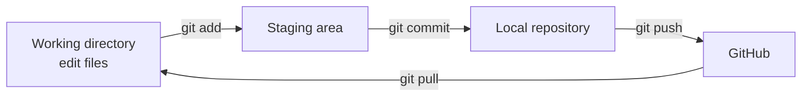

# Git Intro Project

A small practice repository for learning the basics of Git and GitHub at Holberton School.

## What is inside

| File | Purpose |
| --- | --- |
| `README.md` | This file |
| `.gitignore` | Files that Git should not track |
| `improvement.txt`, `message.txt` | Small text files used to practice commits and changes |

## Git workflow

This is the basic cycle used in this project:



## Main commands

```bash
git status                 # see what changed
git add file_name          # add a file to the staging area
git commit -m "message"    # save the changes locally
git push                   # send the commits to GitHub
git pull                   # get the latest changes from GitHub
git log --oneline          # see the history
```

## What I practiced

- Creating and cloning a repository
- Staging and committing changes
- Pushing and pulling from GitHub
- Using `.gitignore`

## Author

Arif Almusharafi - [GitHub](https://github.com/arif-almusharafi)
